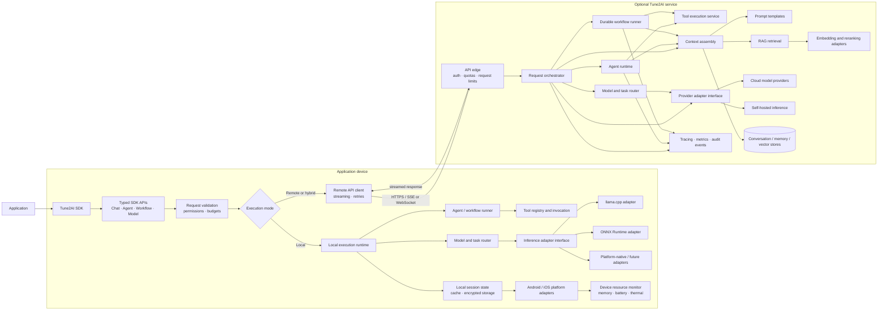

# Tune2AI architecture refinement

Rendered architecture diagram: [tune2ai-updated-architecture.svg](tune2ai-updated-architecture.svg).

## Working assumption

Tune2AI is a mobile-first SDK that lets an application run AI locally, remotely, or in a hybrid mode. The diagram does not specify which features are hosted by Tune2AI, so the cloud services below are optional deployment components rather than a claim that they already exist.

## Proposed architecture

## What changed from the current drawing

- **Separate device and cloud boundaries.** The original drawing sends arrows across layers without showing which components run in the app, on the device, or on a Tune2AI service.
- **One request path.** Chat, agent, workflow, and model APIs enter through a shared validation and dispatch path. They remain distinct SDK capabilities, but do not each imply a separate orchestration stack.
- **Distinguish execution from capabilities.** Agent/workflow runners execute steps; context, retrieval, prompts, and model adapters are services they call.
- **Make routing explicit.** A model/task router selects a local backend, hosted provider, or self-hosted model through adapter interfaces. This keeps provider-specific behavior out of the SDK API surface.
- **Treat tools as a security boundary.** Tool registration, permissions, and invocation are explicit. For cloud execution, tools should run in a constrained service; for local execution, the application must grant capabilities.
- **Give storage and operations a place.** The current diagram omits conversation/memory persistence, request tracing, failures, and audit events, all of which matter once requests cross process or network boundaries.

## Suggested responsibilities

| Component | Owns | Should not own |
|---|---|---|
| SDK APIs | Stable typed interface, cancellation, streaming events, error types | Provider-specific routing rules |
| Local execution runtime | On-device agent/workflow execution and session lifecycle | Cloud credentials or server-only secrets |
| API edge | Authentication, quotas, payload limits, versioning | Agent reasoning or workflow state |
| Request orchestrator | Request lifecycle, routing decisions, response assembly | Provider SDK details |
| Agent/workflow runners | Step execution, checkpoints, tool handoffs | Model transport implementation |
| Model adapters | Provider/backend protocol translation and capability reporting | Product-level policy |
| Context services | Prompt assembly, retrieval, memory reads/writes | Arbitrary tool execution |
| Tool execution | Permission checks, invocation, timeout and result shaping | Unrestricted access to host resources |

## Decisions to settle before implementation

1. **Deployment boundary:** Which functions are fully on-device, which require a Tune2AI backend, and which can run either way?
2. **Workflow durability:** Are workflows expected to survive app closure, device restart, or network loss? If yes, durable checkpoints belong on a service or explicitly supported local store.
3. **Tool trust model:** Can apps register arbitrary code, or only declarative/host-provided tools? This determines sandboxing and permission design.
4. **State ownership:** Is conversation and memory state owned by the app, stored locally by the SDK, or stored by a cloud service? Make this configurable and explicit in the API.
5. **Model configuration:** Is the model catalog static in the SDK, remotely managed, or supplied by the application? Avoid a single “Model Manager” box until this ownership is clear.

## Diagram conventions for the next revision

- Use solid arrows for request/data flow and dashed arrows for configuration/control flow.
- Label network boundaries and protocols, including the streaming mechanism.
- Mark optional components with “optional” and name the execution location for every box.
- Keep the main request path left to right; place cross-cutting concerns such as telemetry and policy alongside it rather than routing every arrow through them.
- Use consistent names: “model adapter” for backend integrations; reserve “model catalog/registry” for metadata and availability.
