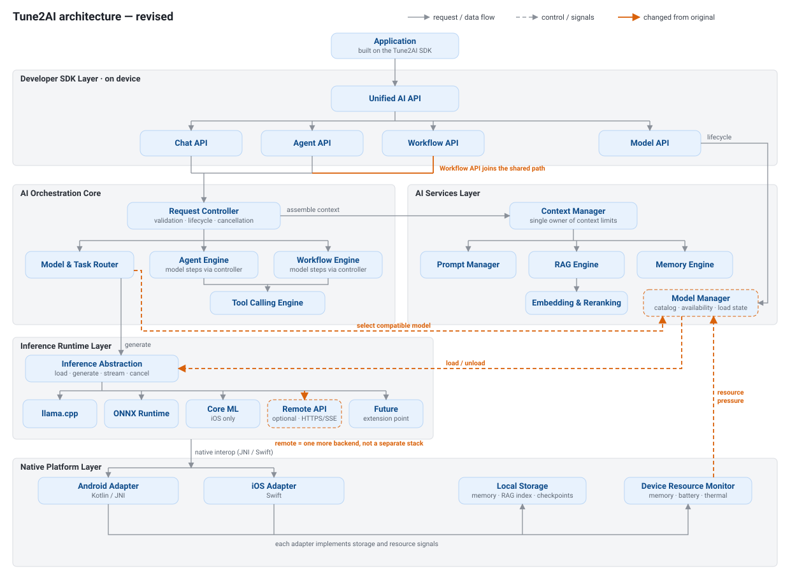

# Tune2AI architecture refinement

Source: [scripts/architecture_diagram.py](../scripts/architecture_diagram.py) (`python scripts/architecture_diagram.py docs/architecture.svg`). Orange elements are the changes from the [original drawing](original-architecture.jpeg).

Requirements: [requirements.md](requirements.md). Backlog: [backlog/](backlog/README.md).

## Working assumption

Tune2AI is an on-device SDK. Everything in the diagram runs inside the application process. Remote execution is supported as one more inference backend, not as a separate cloud stack, so routing, context assembly, tools, and the event contract are the same whether a model runs locally or remotely.

## Changes from the original drawing

1. **One request path.** Chat, Agent, and Workflow APIs all enter through the Request Controller. The Workflow API no longer bypasses it to reach the Workflow Engine, so validation, cancellation, and request IDs are handled once.
2. **The Router asks the Model Manager.** The Model & Task Router selects a model from the Model Manager's catalog, availability, and load state before calling the Inference Abstraction. Availability is decided in one place.
3. **The Model Manager owns load/unload.** Model lifecycle reaches the runtime through the Model Manager. The Model API talks to the Model Manager directly because lifecycle calls are not inference requests.
4. **Context goes through the Context Manager only.** The direct Agent Engine → Memory Engine edge is removed. Agent and workflow model steps go back through the Request Controller, which asks the Context Manager, so context limits are enforced in one component.
5. **Resource signals flow upward.** The Device Resource Monitor feeds the Model Manager, which lets routing and model loading react to memory, battery, and thermal pressure.
6. **Remote is a backend.** "Remote API" sits next to llama.cpp, ONNX Runtime, and Core ML behind the Inference Abstraction. It is optional and uses HTTPS with SSE streaming.
7. **Native adapters implement storage and resource signals.** Inference backends reach native code through the Android (Kotlin/JNI) or iOS (Swift) adapter. Each adapter provides Local Storage and Device Resource Monitor.

## Responsibilities

| Component | Owns | Should not own |
|---|---|---|
| SDK APIs | Stable typed interface, cancellation, streaming events, error types | Routing rules, backend details |
| Request Controller | Validation, request lifecycle, request IDs, result assembly | Model selection logic, backend protocols |
| Model & Task Router | Choosing a model and backend for a task | Model metadata or load state (asks Model Manager) |
| Agent / Workflow Engines | Step execution, iteration limits, checkpoints, tool handoffs | Direct memory or storage access outside their checkpoints |
| Tool Calling Engine | Schema validation, permissions, invocation, timeouts | Unrestricted access to host resources |
| Context Manager | Prompt assembly, retrieval, memory reads/writes, context limits | Tool execution |
| Model Manager | Catalog, compatibility, availability, load/unload | Request routing policy |
| Inference backends | Translating the shared inference contract to llama.cpp, ONNX Runtime, Core ML, or a remote API | Product-level policy |
| Native adapters | Platform calls, Local Storage, resource signals | Shared runtime logic |

## Technical decisions

These are the defaults the backlog tasks are written against. Change a decision here first, then update the affected stories.

| ID | Decision | Why | Revisit when |
|---|---|---|---|
| D1 | The SDK is written in **Kotlin** as Android library modules. Shared runtime code (`api`, `core`, `services`, `inference` packages) must not import `android.*`. | Matches the Kotlin/JNI adapter in the diagram. Keeping Android imports out of the shared packages lets them move to Kotlin Multiplatform `commonMain` without rewrites. | iOS work starts (milestone 8): convert to Kotlin Multiplatform and add an iOS target. |
| D2 | Streaming uses **kotlinx-coroutines `Flow`**; cancellation is coroutine cancellation. JSON (tool schemas, workflow definitions, checkpoints) uses **kotlinx-serialization-json**. | Standard Kotlin streaming and cancellation; both libraries are multiplatform and work in JVM unit tests, unlike `org.json`. | — |
| D3 | Module layout: `:sdk` (APIs, orchestration, services, inference abstraction, Android adapter), `:sdk-llama` (llama.cpp via NDK/JNI), `:sdk-onnx`, `:sdk-remote`. `:app` (Tune2AI Studio) is the Android sample. | Apps include only the backends they use; `:sdk` alone has no native code and no network permission. | A module would hold one class: merge it. |
| D4 | The Remote API backend uses `HttpURLConnection` and parses SSE by hand. | Avoids an HTTP client dependency for one streaming endpoint. | Retries, HTTP/2, or several providers make it painful: switch to OkHttp. |
| D5 | Local storage starts as SQLite through the Android framework API (`SQLiteOpenHelper`). The vector index starts as a brute-force cosine scan. | No dependencies; correct for small corpora. | RAG corpora exceed ~10k chunks or retrieval exceeds the latency budget in [requirements.md](requirements.md). |
| D7 | The Remote API backend speaks the **OpenAI-compatible Chat Completions** API with SSE streaming. The API key comes from an app callback per request and is never stored. | One adapter covers OpenAI, vLLM, Ollama, llama.cpp server, and most hosted providers. | A provider without an OpenAI-compatible endpoint is needed: add another wire format to `RemoteBackend`. |
| D8 | **ONNX Runtime is deferred.** On-device models run through llama.cpp (GGUF); larger models through the Remote API backend. | ONNX Runtime GenAI is not published for Android on Maven Central; plain `onnxruntime-android` would need our own tokenizer and KV-cache code per model family. | A required model ships only as ONNX, or ONNX Runtime GenAI is published for Android. |
| D9 | `:app` JVM unit tests use `org.json:json` (test scope only). | Studio code uses Android's `org.json`, which is a throwing stub in JVM unit tests; the reference implementation makes those classes testable without Robolectric. Ships in no APK. | Studio moves its JSON handling to kotlinx-serialization, or adopts Robolectric. |
| D10 | **Privacy guard on by default** (`Tune2AI.privacy`): sensitive values (one-time codes, card/account numbers, government IDs, passwords, keys) in knowledge, app context sources, and agent tool results are replaced before any model sees them, and no knowledge or app context is attached to requests on network backends unless the app sets `personalContextWithRemote`. Applied in the Context Manager and the agent loop, so every request path is covered. | Phone data (SMS, notifications, files) is the most sensitive input the SDK handles; redaction and keeping it local must not depend on each app remembering to do it. | Apps need a classifier beyond patterns (false negatives), or a remote backend runs inside a trusted boundary. |
| D6 | Tools are host-provided: the app registers Kotlin handlers with a JSON schema. No downloaded or interpreted code. | Answers the tool trust question with the smallest safe surface. | A real need for user-defined tools appears. |
| D11 | **Hardware acceleration in `:sdk-llama`**: llama.cpp backends are separate libraries loaded at start-up (`GGML_BACKEND_DL`, shared C++ runtime): CPU, OpenCL (Adreno; Khronos `OpenCL-Headers` and `OpenCL-ICD-Loader` submodules, the loader used only to link and kept out of the APK so the phone's own `libOpenCL.so` is used), and Vulkan (`Vulkan-Headers`, `SPIRV-Headers` submodules; API 28+). Qualcomm Hexagon NPU is opt-in via `-PTUNE2AI_HEXAGON_SDK`. The app picks Auto, CPU, GPU or NPU. Each GPU/NPU candidate must load the model and pass a warm-up decode, otherwise the next one is tried, then CPU. OpenCL only gets model formats verified on Adreno (F32, F16, Q4_0, Q8_0). `GpuCrashGuard` keeps a model on CPU after a GPU run killed the process. | Phone GPUs run models several times faster than CPU, but vendor drivers fail in ways that cannot be caught: the Adreno 750 Vulkan driver rejects ggml shaders built with the NDK's 2022 `glslc`, and its OpenCL driver exits the process on Q4_K kernels. A backend whose driver is missing must not stop the app loading. | A newer `glslc` makes Vulkan pass on Adreno; more formats pass `GpuProbeTest` on OpenCL; Hexagon support is needed for NPU-only devices. |

## Decisions still open

1. **State ownership:** is conversation and memory state owned by the app or stored by the SDK? Default until decided: stored by the SDK in app-private storage, clearable by the app (T2AI-004, T2AI-025).
2. **Model catalog source:** is the catalog static in the SDK, supplied by the application, or fetched remotely? Default until decided: supplied by the application (T2AI-020).

## Diagram conventions

- Solid arrows are request/data flow; dashed arrows are control flow and signals.
- Every component runs on the device. Anything that leaves the device is labelled with its protocol.
- Use "backend" for inference integrations and "Model Manager" for metadata and lifecycle.
